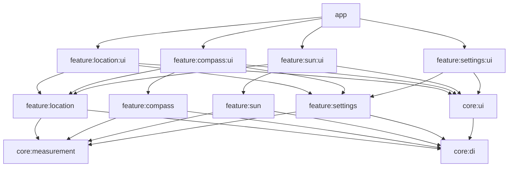

# ARCHITECTURE.md

How Positional is put together. Rules, commands, and boundaries live in [AGENTS.md](AGENTS.md);
coding conventions live in `.claude/rules/`. This document describes structure and data flow only.

## Shape of the app

One process, one Activity (`MainActivity`), all UI in Jetpack Compose. `MainView` gates everything
behind the fine location permission, then shows four tabs: Location, Compass, Sun, and Settings.
Each feature exposes a domain interface backed by an Android system service or a pure calculation,
and a ViewModel per screen turns that interface's `Flow`s into a single `StateFlow` for its View.

`core:error` (boundary error handling) and `core:test` (shared test utilities) sit beside this
graph and are pulled in where needed. `app` also depends directly on `feature:location` and
`feature:settings`.

## Features

| Feature | Domain interface | Implementation | Source of data |
|---|---|---|---|
| Location | `Locator.location: Flow<Location>` | `AospLocator` (`aosp`), `GmsLocator` (`gms`, falls back to `AospLocator`) | `LocationManager` / `FusedLocationProviderClient` |
| Compass | `Compass.azimuth: Flow<Azimuth>` | `AospCompass`; the binding is `null` when the device lacks the accelerometer, magnetometer, or rotation-vector sensor | `SensorManager` |
| Sun | `SolarTimesRepository` | `MainSolarTimesRepository` (pure Kotlin, no Android) | `com.luckycatlabs:SunriseSunsetCalculator` |
| Settings | `SettingsRepository` | `DataStoreSettingsRepository` | Proto DataStore file `settings.proto`, schema in `feature/settings/src/main/proto`, generated with Wire |

Cross-feature reuse happens at the domain layer: the Compass screen reads `Locator` to compute
magnetic declination, and the Sun screen reads `Locator` for the coordinates to calculate against.

`core:measurement` holds the shared value types: `Angle`, `Distance`, `Speed`, `Units`, and the
`Coordinates` hierarchy (`GeodeticCoordinates`, `UtmCoordinates`, `MgrsCoordinates`). UTM/MGRS
conversion goes through NASA WorldWind (`WorldWindConversions.kt`). Formatting coordinates for
display belongs to `feature:location:ui` (`ui/format/`), not to the models.

## Data lifecycle

This is how the privacy constraint in AGENTS.md is met:

- **Location** exists only in memory: sensor callback → `Flow` → ViewModel `StateFlow` → Composable.
  Nothing writes it to disk, logs it, or sends it anywhere.
- **At rest** the app persists only the user's settings (the Proto DataStore above). Android backup
  uses the platform defaults (`app/src/main/res/xml/backup_rules.xml`).
- **Leaving the device**:
  - Crash reports go to Firebase Crashlytics, enabled only in release builds
    (`PositionalApplication`). In release, Timber logs go to `CrashlyticsTree`, which forwards only
    the attached `Throwable`, never the message.
  - The user can open their location in another app through an `ACTION_VIEW` `geo:` intent
    (`LocationView`). This happens only when the user asks for it.

## Dependency injection

Metro, with one graph: `AppGraph` in `app`, scoped to `AppScope` (declared in `core:di`).
`PositionalApplication` creates the graph, and `MetroAppComponentFactory` (declared in the manifest)
uses it to construct `MainActivity` with constructor injection. Every other module adds to the graph
with contribution annotations, and ViewModels reach Composables through `LocalMetroViewModelFactory`.
App-wide primitives (`Clock`, `CoroutineContext`, `Locale`, `TimeZone`) are provided in
`AppProviders`, so features can inject them and tests can replace them.

## Navigation

Navigation 3. Each `ui` module defines its destinations as `NavKey`s (e.g. `LocationNavKey`,
`LocationHelpNavKey`); the four tab roots implement `MainNavKey` from `core:ui`, which adds the
tab's icon and label. `MainView` keeps a separate back stack per tab and switches between a bottom
navigation bar and a navigation rail based on window width class.

## Flavors

`aosp` and `gms` differ only where Google Play Services is used:

- `feature:location`: `src/aosp` binds `Locator` to `AospLocator`; `src/gms` contributes
  `GmsLocator` and the `FusedLocationProviderClient`.

`app` has no flavor-specific code or dependencies. Crashlytics ships in both flavors. The app has
no Firebase Analytics: Crashlytics works without it, and it would add usage tracking and the
advertising ID permission. Without it, Crashlytics reports have no breadcrumb logs.

## Build logic

Convention plugins in `build-logic/convention` (`io.trewartha.positional.*`):

| Plugin | Applies |
|---|---|
| `library.android` | Android library defaults: SDK levels, `aosp`/`gms` flavors, module-derived resource prefix, testFixtures, Gradle Managed Devices |
| `library.jvm` | Pure-Kotlin library defaults, including `testFixtures.jvm` |
| `metro` | Metro compiler plugin |
| `detekt` | Detekt with the root `detekt.yml` |
| `dependencyAnalysis` | `com.autonomousapps.dependency-analysis` |
| `testFixtures.jvm` | testFixtures for pure-Kotlin modules |

## Test seams

Every domain module publishes `testFixtures` with a fake of its interface (`TestLocator`,
`TestCompass`, `TestSolarTimesRepository`, `TestSettingsRepository`), and most also publish
`RandomFixtures.kt` generators for their models. ViewModel specs in `ui` modules depend on those
fixtures rather than on real implementations. `core:test` holds the shared building blocks
(`FakeClock`, random value generators).
